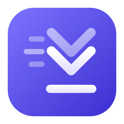

  

<h1 align="center">Velocity — Fast Downloader</h1>

  <b>A free, fast and private download manager.</b> 
  Multi-connection downloads · pause & resume anytime · no ads · no tracking

  
  &nbsp;
  

  
  
  
  
  

---

## ⬇️ Download

| Platform | File | Notes |
|---|---|---|
| **Windows 10 / 11 (64-bit)** | [**Velocity_x64-setup.exe**](https://github.com/qwertiian/velocity-fast-downloader/releases/latest/download/Velocity_x64-setup.exe) | Recommended. No admin rights needed. |
| Windows (IT / managed PCs) | [Velocity_x64.msi](https://github.com/qwertiian/velocity-fast-downloader/releases/latest/download/Velocity_x64.msi) | For deployment tools such as Intune or Group Policy. |
| macOS | Coming soon | |
| Linux | Coming soon | |

All versions, release notes and checksums: **[Releases page](https://github.com/qwertiian/velocity-fast-downloader/releases)**

> **First launch on Windows:** you may see *"Windows protected your PC"*. That appears for
> new apps that aren't code-signed yet. Click **More info → Run anyway**.
> [Why this happens and how to verify your download](guide/INSTALL.md#windows-smartscreen-warning)

---

## What is Velocity?

Velocity downloads files from the internet faster and more reliably than a browser:

- **🚀 Multiple connections at once.** When the server allows it, a file is split into parts
  that download in parallel, and idle connections help the slower ones finish.
- **⏸️ Pause and resume anytime,** even after closing the app, losing your connection or
  restarting your PC.
- **🔁 Automatic recovery.** Dropped connections and server hiccups are retried automatically.
- **🧠 Plays nice with servers.** If a server says "too many connections", Velocity backs off
  instead of getting blocked.
- **🛡️ Safe by design.** It refuses to mix data if the file changed on the server, verifies
  checksums if you provide one, never runs downloaded programs automatically, and sanitizes
  file names.
- **🎚️ Speed limits,** overall or per download, so the rest of your household can still browse.
- **🗂️ Organized.** Automatic categories (Videos, Documents, Archives…), search, filters and
  statistics.
- **📋 Catches your downloads.** Copy a download link in your browser ("Copy link address")
  and Velocity pops up asking whether to download it.
- **🕘 Works in the background.** Lives in the notification area, keeps downloading when the
  window is closed, and can start with Windows.
- **🔄 Updates itself.** New versions install from inside the app, and only after their digital
  signature is verified.
- **🧭 Honest about links.** If a link opens a web page instead of the file, Velocity tells you
  and explains what to do, instead of saving the page silently.
- **🖥️ Classic Windows interface:** menu bar, toolbar, folder tree, sortable list and right-click
  menus, with Classic (light) and Classic Dark themes.
- **🔒 Private.** No account, no ads, no telemetry. Your history stays on your computer.

> **About speed:** extra connections help most with distant or busy servers. Velocity can't make
> a download faster than your internet plan or what the server allows.

## Quick start

1. **Download** the installer above and run it.
2. **Choose** your download folder on first launch.
3. **Copy any download link** in your browser (right-click → *Copy link address*). Velocity
   pops up and asks whether to download it. You can also click **Add URL** (or press
   **Ctrl + N**) and paste the link.
4. Velocity checks the link, shows the file name and size, and starts downloading.

Full guide: **[How to use Velocity](guide/USER_GUIDE.md)**

### Keyboard shortcuts

| Keys | Action |
|---|---|
| `Ctrl + N` | Add a download |
| `Ctrl + V` | Paste a link anywhere to add it |
| `Ctrl + F` | Search downloads |
| `Space` | Pause / resume the selected download |
| `Delete` | Remove the selected download(s) from the list |
| `Enter` | Open the file (or show properties if unfinished) |
| `Alt + Enter` | Properties |
| `Ctrl + A` | Select all |
| Right-click | All actions for the selected downloads |

## Help

- 📘 [Installation guide](guide/INSTALL.md)
- 🧭 [User guide](guide/USER_GUIDE.md)
- ❓ [FAQ & troubleshooting](guide/FAQ.md)
- 🐞 [Report a bug](https://github.com/qwertiian/velocity-fast-downloader/issues/new?template=bug_report.md) · 💡 [Request a feature](https://github.com/qwertiian/velocity-fast-downloader/issues/new?template=feature_request.md)

## Roadmap

- [x] Windows app with multi-connection downloads, pause/resume, queue, speed limits, statistics
- [x] Background mode, clipboard catcher, classic interface (v0.2)
- [ ] Browser extensions (Chrome, Edge, Firefox) to send downloads to Velocity with one click
- [ ] macOS and Linux versions
- [ ] Scheduled downloads and multiple queues
- [x] Automatic updates (signed)
- [ ] Code-signed installers (removes the Windows warning)

## Responsible use

Velocity is for downloading files you have the right to download. It does not bypass DRM,
paywalls, logins or website restrictions.

## Privacy & licence

- [Privacy policy](PRIVACY.md): Velocity collects nothing.
- [Security policy](SECURITY.md): how to report vulnerabilities.
- [Licence](LICENSE): free for personal and commercial use.
- [Third-party notices](THIRD_PARTY_NOTICES.txt): open-source components included in Velocity and their licences (also in the app under Help → Third-party licences).
